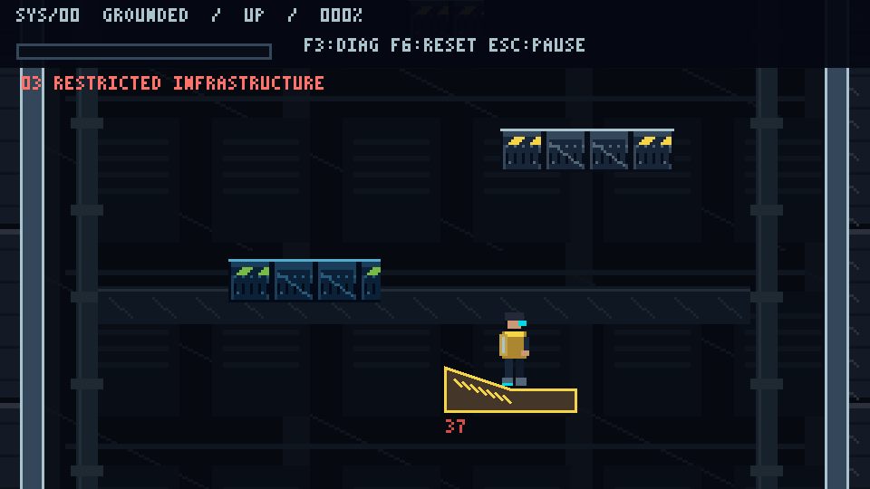

# Cyberpunk: The Last Ascent

## Milestone 02F

Open **Physics Lab 2.0** and choose **R Slide**, **S Reverse**, **T Jump Lock**, **U Connected** or **V Fall Penalty**. Orange ramp faces commit David to a downhill route until the runout. F3 shows the movement state and F6 resets the selected fixture. The main tower and the lab share the revised David sprite.

- [Forced-slide behavior and configuration](docs/physics-spec.md#milestone-02f-forced-downhill-obstacles)
- [Character proportions and animation keys](docs/character-art-guide.md#milestone-02f-prototype)
- [Native and enlarged visual review](docs/visual-review/milestone-02f/README.md)

## Milestone 02E

The shared player now uses an original animated David Martinez prototype with nine animation sets. Designated ramps build downhill speed from rest. Select **O Shallow**, **P Tower Ramp** or **Q Steep** in Physics Lab 2.0 to try the revised movement. **F3** shows support, slope angle and slide status.

- [Character art guide and sprite production](docs/character-art-guide.md)
- [Native and enlarged engine captures](docs/visual-review/milestone-02e/README.md)
- [Slope measurements and test procedure](docs/physics-spec.md#milestone-02e-slope-movement)
- [Environmental geometry standard](docs/level-design.md#environmental-geometry-standard)

A 2D precision-platforming prototype built with **Godot 4.7.2 and GDScript**, inspired by Cyberpunk: Edgerunners and Jump King. Hold to charge, choose a direction, release, and commit to the jump. Climb a continuous tower through deliberate positioning, controllable ice, ramps and wall ricochets.

This is an unofficial, noncommercial fan project in active development. The current playable game has four connected prototype floors. The proposed eight-region narrative, cyberware and ending remain future design scope.

## Current status

Milestone 02D implements the continuous **four-floor tower ascent: 60 landings / 3008 vertical pixels**, shared controllable ice, smooth fractional/interpolated rendering and universal configurable wall/platform-side rebounds. Start Tower Ascent is the main game; Physics Lab 2.0 and the original Power Chamber remain accessible. Normal launch tuning/collider/art assets are preserved. **Physics manually approved by the project owner on 11 November 2026**, following the completed Milestone 02D playtest. Engine tests pass. Full-route pacing, final art, exports and longer performance testing remain separate acceptance work. See [measured validation and all launch recipes](docs/validation/milestone-02d.md) and the [manual checklist](docs/physics-spec.md#manual-acceptance-checklist-physics-approved-retain-for-regressions).



*Actual Godot Compatibility-renderer capture; staged for visual review.*

## What is playable

- **Tower Ascent:** 60 numbered landing destinations across four connected floors, spanning 3,008 vertical pixels.
- **Committed charge jumps:** configurable charge/release trajectories, directional selection, no default air steering or double jump.
- **Surface mechanics:** controllable moderate ice, configurable mild/extreme profiles, polygon slopes and gravity ramps.
- **Universal side rebounds:** configurable wall/platform-side restitution, moving-side relative velocity and optional bounded diagonal redirection.
- **Consequential falls:** continuous world coordinates, earlier-floor recovery and no automatic checkpoint teleportation.
- **Physics Lab 2.0:** directly selectable calibration, surface, ceiling, ledge, ricochet and combined challenges; optional collision/trajectory traces.
- **Power Chamber:** the original industrial visual slice, using the same player controller and original project artwork.
- **Diagnostics:** F3 state/surface/velocity/impulse/zone/height readout; deterministic solver-based validation.

## Development milestones

| Milestone | Delivered |
| --- | --- |
| 00 | Godot project foundation, input conventions, design documents and validation tools |
| 01 | Charge/release player controller, measured jump envelope and Classic ascent laboratory |
| 02A | Original industrial pixel-art assets, reusable environment components and Power Chamber |
| 02B | Surface profiles, ice/slopes/ramps, contact responses, moving fixtures and expanded lab |
| 02D | Refined ice and rendering, universal side rebounds, ricochet puzzles and continuous four-floor ascent |

The current physics has been user-approved. Milestone numbering follows the supplied task briefs; no 02C implementation is implied.

## Documentation

| Document | Contents |
| --- | --- |
| [Session summary](docs/session-summary-2026-11-11.md) | Work completed during the development session, approval, measurements and remaining scope |
| [Development log](docs/development-log.md) | Detailed implementation history, decisions and validation results |
| [Physics specification](docs/physics-spec.md) | Jump equations, tuning Resources, surfaces, rebound rules and manual checklist |
| [Level design](docs/level-design.md) | Four-floor layout, world coordinates, progression and recovery |
| [Measured validation](docs/validation/milestone-02d.md) | Ice comparisons, ricochet measurements and all 60 landing recipes |
| [Technical design](docs/technical-design.md) | Shared controller, scene architecture, rendering and diagnostics |
| [Game design](docs/game-design.md) | Core loop and future campaign concept |
| [Roadmap](docs/roadmap.md) | Current acceptance status and proposed future work |
| [Visual style guide](docs/visual-style-guide.md) / [asset manifest](docs/asset-manifest.md) | Art conventions and asset provenance |
| [Visual review](docs/visual-review/milestone-02d/README.md) | Actual engine captures and review limitations |
| [Agent instructions](AGENTS.md) | Project conventions and required checks for future development |

## Clone and run

```sh
git clone https://github.com/Arun-D-Algo/cyberpunk-the-last-ascent.git
cd cyberpunk-the-last-ascent
```

Import `project.godot` in Godot 4.7.2, press **F5**, then select **Start Tower Ascent**. No external game packages, account credentials or paid services are required. The `.godot` cache is regenerated locally and is intentionally excluded from Git.

## Prerequisites and opening

- Confirmed engine: **Godot 4.7.2 stable**, reporting `4.7.2.stable.official.ed1daf0bf` from the user's Tools/Godot installation. Verify your executable with `--version` on another machine.
- Standard Godot build (GDScript); .NET is unnecessary. Desktop Windows or Linux. Git for version control; PowerShell 7 or Windows PowerShell for the static check.
- Obtain the engine from [the official Godot download page](https://godotengine.org/download/) if needed; installation/extraction is a user action. If the requested version is unavailable, agree on a supported version before changing the target.
- In Godot's Project Manager choose **Import**, select this directory's `project.godot`, then **Import & Edit**. Press **F5**, click **Start Tower Ascent** for the connected main game. For isolated mechanics click **Enter Physics Lab 2.0** and use the **CLASSIC** dropdown at upper right to select an experiment. **Enter Power Chamber** remains available. Close the game window to exit.

From PowerShell, with your actual executable path:

```powershell
Set-Location 'C:\Users\Arunangshu Dasgupta\OneDrive\Repositories and Projects\Cyberpunk_Game\cyberpunk-last-ascent'
$GodotExe = 'C:\Users\Arunangshu Dasgupta\Tools\Godot\godot_console.exe'
& $GodotExe --version
& $GodotExe --editor --path .
# Or run directly:
& $GodotExe --path .
```

The machine-specific locations above are opening instructions only; runtime resources use res://. On another machine replace the executable/checkout locations. On Linux, `cd` to the checkout and use `godot --editor --path .` / `godot --path .`.

## Controls

Actions are configured centrally. Letter keys use physical positions; Shift/Ctrl require the left location. Godot's ui_* defaults support native UI and are not alternate player movement bindings. Cyberware/interact/boss actions are reserved and have no M01 behavior.

| Key | Action | Intended behavior |
| --- | --- | --- |
| A / Left Arrow | move_left | Move/select left jump direction |
| D / Right Arrow | move_right | Move/select right jump direction |
| W / Up Arrow | look_up | Look upward |
| S / Down Arrow | look_down | Look downward |
| Space | jump_charge | Hold to charge, release to jump |
| Left Shift | cyberware_primary | Primary ability |
| Left Ctrl | cyberware_secondary | Secondary ability |
| E | interact | Interact |
| Esc | pause_game | Pause |
| R | retry_boss | Request boss retry |
| F3 | debug_toggle_overlay | Toggle lab measurements (debug builds) |
| F6 | debug_reset_lab | Reset current prototype player, camera and measurements (debug builds) |

## Visual prototype and art pipeline

Read [visual-style-guide.md](docs/visual-style-guide.md) for palette, pixel scales, composition, UI and animation rules. The [review package](docs/visual-review/milestone-02a/README.md) includes actual Godot starting/middle/upper views, a full-room overview, native/3× previews, atlas and before/after comparison. Positions are staged on real platforms for art review; screenshots are not claims of a human playthrough. Artistic approval is the user's decision.

Climb the chamber's six service ledges toward **EXIT / UPPER RELAY**. Existing charge/commit physics are unchanged. The upper door is a marked exit placeholder, with no region transition. F3/F6/Esc work in both prototypes. A+Right Arrow and Left Arrow+D retain neutral behavior; no separate arrow movement logic exists.

Original editable art source: tools/generate_art.gd. Run it headless to rebuild PNG/FNT assets, then import and test. Palette is assets/environment/industrial/palette.gpl; atlas region definitions are in IndustrialArt. No paid services, downloaded sprites, copied logos, external font or proprietary assets were used. See [asset manifest](docs/asset-manifest.md). Decorative fans/lamps/sparks/steam never act as hazards.

```powershell
& $GodotExe --headless --path . --script res://tools/generate_art.gd
& $GodotExe --headless --editor --path . --import
& $GodotExe --path . --scene res://scenes/regions/sublevel_zero/emergency_power_chamber.tscn
# After import, capture actual scene images (requires a graphical render device):
& $GodotExe --path . --script res://tools/capture_visual_review.gd -- --initial-art
& $GodotExe --path . --script res://tools/capture_visual_review.gd
```

## Playing and tuning the lab

The upper-right selector offers Classic plus A Jumps, B Walls, C Ceiling, D Ledges, E Ice, F Slopes, G Ramps, H1/H2/H3 combined challenges, and I-N ricochet/diagonal sections. Selection moves directly to that experiment, with no prerequisite climb. F6 resets the current section, moving-platform phase, velocity, charge, metrics and camera. TRACE toggles actual collider bounds, support normal, velocity and recorded jump path; it is a diagnostic history, not a predicted launch assist. F3 expands surface/friction/normal/slope/slide/impact/eligibility readouts. The debug panel intentionally covers much of the arena only when enabled.

Normal surfaces retain the approved stop-and-charge behavior. Ice retains landing momentum and has much lower drag; a fresh charge press is rejected above 12px/s until you brake and release/repress. Yellow-patterned gravity ramps accelerate downhill up to 150px/s and require speed ≤6px/s to charge. Normal inclines do not auto-slide. Accepted charges are stationary on all supplied profiles. Ordinary airborne wall/platform-side impacts rebound at 60% above 30px/s relative speed. The older magenta comparison fixture retains 25%; supported walking corners stop. Moving supports carry you while standing but do not inject a departure jump boost by default. Surface coefficients, not movement code copies, define these differences.

Tune resources/surfaces/*.tres and resources/physics/*collision_response.tres in Godot's Inspector. Baseline launch parameters stay in default_player_physics.tres; m01_baseline.tres preserves prior values. See physics-spec.md for exact precedence, units, measured stops/reversals/ramp-control trial and the manual acceptance checklist. Current physics has automated coverage and owner playtest approval; future tuning still requires regression and feel checks.

A/D or Left/Right walks while grounded. Hold Space to charge while stationary, choose direction, release to jump. Neither direction or opposite directions gives a vertical jump. Taps produce minimum strength; full charge stays capped until release. Air steering is disabled. W/S or Up/Down looks within safe camera limits. Esc pauses/resumes; pausing or losing focus cancels charge, so release and press Space again before another attempt. F6 resets without reloading; R is not repurposed. Holding Space through landing never automatically charges another jump.

Climb the numbered platforms toward LAB COMPLETE. The first steps teach short/medium jumps; upper 52–56px rises require near-full charge. All platforms are solid, so feet must clear the destination's side before crossing it. Falling loses altitude but returns to a lower platform/floor. F3 shows state, position, velocity, support, charge and last completed jump measurements. It is a developer overlay and deliberately covers part of the arena when visible.

Open resources/physics/default_player_physics.tres to tune the exported Resource; read [physics specification](docs/physics-spec.md) for units, equations, defaults and measured envelopes. Keep future difficulty modes on the same physics. After any change, rerun the physics tests and route check; do not assume earlier platform spacing remains valid.

## Structure and architecture

```text
project.godot       Project settings and InputMap
scenes/main/       Native boot UI
scenes/player/     Reusable prototype player
scenes/levels/     Continuous four-floor tower and Physics Lab
scenes/hazards/    Reusable hazards
scenes/characters/ NPC scenes
scenes/bosses/     Boss scenes
scenes/ui/         Lab HUD and future UI
scenes/environment/  Reusable industrial platform/fixture components
scenes/regions/sublevel_zero/  One Emergency Power Chamber visual slice
scripts/          core/, player/, camera/, cyberware/, regions/,
                  hazards/, dialogue/, save/, audio/, bosses/, ui/
resources/        definitions/, physics/, difficulty/, camera/,
                  cyberware/, audio/, input/, regions/
assets/           environment/, player/, ui/ original art; future sprite/audio categories
tools/            Editable pixel-art generator and actual-engine review capture
tests/            Static, smoke, physics/integration checks and runner
docs/             Design, technical plan, roadmap and development log
AGENTS.md         Future coding-agent instructions
```

The player, lab, camera, HUD, physics and surface directories contain implemented systems; other future directories keep markers only. scenes/levels/physics_lab.tscn hosts the preserved Classic climb and selectable mechanics fixtures. scripts/player holds baseline/surface/contact definitions, controller, jump calculation, visual and recorder. TowerAscent/TowerRoute and FloorTheme Resources compose the connected main game using shared physics/art. LabSections and PhysicsSurface also provide lab fixtures; the final eight-region campaign remains future work. See [technical design](docs/technical-design.md) and [roadmap](docs/roadmap.md).

## Validation

Run from the project root:

```powershell
powershell -NoProfile -ExecutionPolicy Bypass -File .\tests\validate_static.ps1
& $GodotExe --headless --editor --path . --import
& $GodotExe --headless --path . --quit-after 5
& $GodotExe --headless --path . --script res://tests/smoke_test.gd
& $GodotExe --headless --fixed-fps 60 --path . --script res://tests/physics_test.gd
& $GodotExe --headless --fixed-fps 60 --path . --script res://tests/visual_prototype_test.gd
& $GodotExe --headless --fixed-fps 60 --path . --script res://tests/surface_physics_test.gd
# Repeat the cadence probe with 30, 60 and 120 while project physics stays at 60Hz:
& $GodotExe --headless --fixed-fps 30 --path . --script res://tests/frame_rate_probe.gd
# Automated sequence with isolated writable editor/user paths and engine-error checks:
.\tests\run_validation.ps1 -GodotExe $GodotExe
# Add -Render to generate lab frame PNGs under ignored .godot/.
# Direct lab startup (same project, bypassing boot for development):
& $GodotExe --path . --scene res://scenes/levels/physics_lab.tscn
```

Check exit codes **and** all engine output. Static checks are not a Godot parser. The smoke test checks loaded settings/InputMap/boot bounds. The existing 177-check physics suite measures real movement and lab traversal. The 02A suite adds physical key-event dispatch (all eight movement/look keys and mixed opposites), source-preservation checks, loaded texture/import/atlas validation, actual chamber navigation/collisions/six-jump route, HUD/animation initialization and parallax coverage during look. The runner executes all suites. Human aesthetic approval, varied hardware/scaling and Linux/export behavior remain separate from these results.

In a restricted agent workspace, normal Godot editor/user-data paths may be unwritable. M00 validation temporarily redirected process-local APPDATA/LOCALAPPDATA into ignored `.godot/validation-user` and `.godot/validation-cache`, used a copy of the installed executable in `.godot/validation-engine` with an `_sc_` marker, and supplied absolute `--log-file` paths under `.godot/`. This did not alter the installed engine or machine settings. [Godot self-contained mode](https://docs.godotengine.org/en/4.4/classes/class_editorpaths.html) isolates editor settings; user-data redirection was additionally required. Do not change production user-data settings to work around an agent sandbox.

## Constraints and OneDrive

320x180 logical coordinates, 960x540 initial window, integer canvas_items scaling with kept aspect, interpolated fractional transforms, nearest canvas textures, GL Compatibility renderer, and a provisional fixed 60 Hz physics tick. The `4.7` feature tag matches the confirmed engine series. Do not upgrade/downgrade the agreed engine without recording the decision.

Source writes/readbacks succeeded locally. The parent carries OneDrive attributes; sync health could not be independently established. Keep the project locally available using OneDrive's **Always keep on this device** if appropriate. Avoid concurrent edits on multiple synced machines and allow sync to settle before switching machines. Git ignores `.godot/`, but this does not exclude it from OneDrive. If cache locking/conflicts occur, close Godot and discuss pausing sync or using a user-approved nonsynced checkout. Never move this project automatically.

Normal-ground launch tuning remains user-approved; 02B explicitly refines contact and surface behavior. There is no rebinding/accessibility settings UI, save system, production moving-platform level, combat, knockback or campaign. The character remains a placeholder. New surface feel, prolonged hardware testing, physical input timing, window/high-DPI behavior, Linux and exported builds need manual validation. Minimal moving fixtures use sinusoidal motion, not a production path/region framework. Surfaces above the existing ~45° floor limit are walls. Debug F3/F6/TRACE are prototype tools.

## Fan-project and asset policy

This project is unofficial, unaffiliated with and not endorsed by the Cyberpunk/Edgerunners rights holders. Noncommercial intent does not grant IP rights or publication permission. Do not use extracted game/anime art, music, logos, voices or proprietary files. M02A uses original project atlases, bitmap font and native controls; no third-party assets were imported. Keep content IDs separate from display names so original characters/setting/assets can replace fan content before any public release. Public distribution needs a separate rights review.


02D direct launch: `& $GodotExe --path . --scene res://scenes/levels/tower_ascent.tscn`. F3 shows physics/zone/height/rebounds; F6 explicitly resets the ascent; Esc/focus loss pauses and cancels charge. Misses remain recoverable in the same world. Lab I-N provide wall, raised-pad side, shaft, rising, ice-bank and opt-in diagonal challenges. At 960x540, nearest pixel art now permits one-physical-pixel translation through canvas_items and physics interpolation; a native 320x180 window still has native-pixel stepping.
