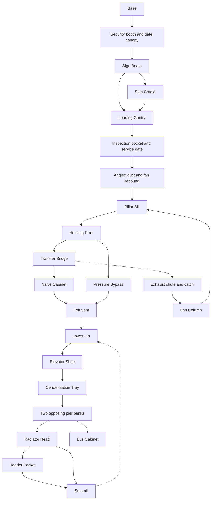

# Milestone 03B route and measured validation

## Baseline audit

03A generated one chain of 36 jumps. All 36 launch directions alternated. The five roof widths occurred 7, 8, 8, 8 and 5 times at 32, 40, 48, 56 and 64 pixels. Rises were 16–60 pixels and absolute center-to-center spans were 52–112 pixels. All destinations were rectangular normal surfaces with rear-plane braces. Four fixed rebound transfers broke the contact sequence, but the level had no authored route forks. The summit fall reached the corporate gate after roughly 1,304 pixels. The saved overview was the comparison baseline.

## Route graph

Each arrow summarizes one or more measured jumps. The table below lists the individual edges. Dashed arrows show tested setbacks.



## Anti-monotony audit

The main line alternates for at most 4 consecutive launches. All 40 named surfaces above the base have an architectural role, including 36 main-route destinations and four branch or recovery landings. This is an authored inventory assessment. Readability and visual integration still need playtesting.

The main-line rise is 20–55 px per jump. Measured absolute launch-to-landing travel is 5.8–115.5 px, including banks. Distinct roof widths range from 24–73 px.

| Roof width (px) | Surface count |
| ---: | ---: |
| 24 | 1 |
| 28 | 1 |
| 31 | 2 |
| 32 | 1 |
| 33 | 1 |
| 34 | 1 |
| 35 | 3 |
| 38 | 3 |
| 40 | 1 |
| 41 | 2 |
| 42 | 1 |
| 43 | 2 |
| 45 | 2 |
| 46 | 1 |
| 48 | 1 |
| 50 | 2 |
| 51 | 1 |
| 52 | 2 |
| 53 | 2 |
| 54 | 1 |
| 55 | 1 |
| 56 | 1 |
| 57 | 2 |
| 60 | 2 |
| 62 | 1 |
| 66 | 1 |
| 73 | 1 |

Silhouettes by count are 20 bracket, 1 slick, 1 slope, 2 solid, 16 stepped. The slick tray is one landing. The sloped shoulder uses ordinary ground contact. Two orange forced-slide faces form a separate descent. The main route has 5 required side impacts. Three fork points offer alternate paths.

The audit flags these endpoints for review where a four-jump window spans at most 8 px in rise and 16 px in measured horizontal travel. RelayBox > CoolingShelf, CoolingShelf > TowerFin.

## Jump recipes

Each recipe acquired solver support and landed at least 5 px inside its destination roof. Both launch offsets of ±0.75 px also reached the target with at least 3 px of margin. Adjacent charge counts show successes at the same position, excluding ticks beyond the 45-tick charge cap. Full charge can be held at the cap. These are measured local samples.

| ID and challenge | Launch → landing | Start x / aim | Charge (s) | Rise / travel (px) | Margin (px) | Banks | Adjacent charge ticks | Landmark or recovery cue |
| --- | --- | --- | ---: | ---: | ---: | ---: | ---: | --- |
| P01 Security booth approach | Base → SecurityBooth | 128.0 / right | 0.500 | 20 / +64.8 | 14.2 | 0 | 2 | Lower ledges remain reachable after a miss. |
| P02 Badge-reader step | SecurityBooth → BadgeReader | 176.0 / right | 0.500 | 28 / +60.8 | 14.2 | 0 | 2 | Lower ledges remain reachable after a miss. |
| P03 Gate canopy ascent | BadgeReader → GateCanopy | 225.5 / right | 0.583 | 41 / +65.7 | 12.8 | 0 | 2 | Lower ledges remain reachable after a miss. |
| P04 Sign span | GateCanopy → SignBeam | 281.5 / left | 0.667 | 33 / -92.8 | 24.3 | 0 | 2 | Lower ledges remain reachable after a miss. |
| P05 Direct loading gantry | SignBeam → LoadingGantry | 187.5 / left | 0.667 | 46 / -82.8 | 20.3 | 0 | 2 | Lower ledges remain reachable after a miss. |
| P06 Low glass lintel | LoadingGantry → GlassLintel | 91.0 / left | 0.450 | 36 / -41.4 | 7.4 | 0 | 1 | Lower ledges remain reachable after a miss. |
| P07 Inspection overhang | GlassLintel → InspectionPocket | 36.5 / right | 0.433 | 22 / +51.3 | 6.8 | 0 | 2 | Medium charge clears the beam. Full charge contacts it. |
| P08 Gate rail exit | InspectionPocket → GateRail | 98.0 / right | 0.583 | 34 / +72.5 | 14.5 | 0 | 2 | Lower ledges remain reachable after a miss. |
| P09 Service duct climb | GateRail → ServiceDuct | 158.5 / right | 0.667 | 42 / +85.3 | 20.2 | 0 | 2 | Lower ledges remain reachable after a miss. |
| P10 Service threshold | ServiceDuct → ServiceGate | 199.5 / right | 0.583 | 45 / +61.2 | 23.7 | 0 | 2 | Lower ledges remain reachable after a miss. |
| V01 Manifold transfer | ServiceGate → Manifold | 263.5 / left | 0.583 | 32 / -74.8 | 25.3 | 0 | 2 | Lower ledges remain reachable after a miss. |
| V02 Outer duct transfer | Manifold → OuterDuct | 184.0 / left | 0.667 | 48 / -80.3 | 21.7 | 0 | 2 | Lower ledges remain reachable after a miss. |
| V03 Angled duct shoulder | OuterDuct → PipeSaddle | 107.0 / left | 0.500 | 26 / -60.8 | 7.2 | 0 | 2 | The 16×12 shoulder is solid. The route launches from the flat roof. |
| V04 Fan sill entry | PipeSaddle → FanSill | 55.5 / right | 0.583 | 40 / +68.0 | 6.5 | 0 | 1 | Lower ledges remain reachable after a miss. |
| V05 Intake column bank | FanSill → FanReturn | 110.0 / right | 0.750 | 44 / -11.9 | 8.9 | 1 | 1 | Bank from the left off the intake column. |
| V06 Fan rim exit | FanReturn → FanRim | 92.0 / left | 0.500 | 32 / -56.7 | 13.3 | 0 | 2 | Lower ledges remain reachable after a miss. |
| V07 Pillar sill | FanRim → PillarSill | 43.0 / right | 0.583 | 35 / +72.5 | 5.5 | 0 | 1 | Lower ledges remain reachable after a miss. |
| V08 Housing roof | PillarSill → HousingRoof | 103.5 / right | 0.583 | 45 / +61.2 | 19.7 | 0 | 2 | Lower ledges remain reachable after a miss. |
| V09 Transfer bridge | HousingRoof → TransferBridge | 178.0 / right | 0.500 | 22 / +64.8 | 15.2 | 0 | 2 | Lower ledges remain reachable after a miss. |
| V10 Outer wall bank | TransferBridge → ValveCabinet | 220.5 / right | 0.750 | 51 / +66.9 | 16.6 | 1 | 1 | Bank off the right boundary. A missed bridge approach can enter the chute. |
| V11 Exit duct | ValveCabinet → ExitVent | 281.5 / left | 0.583 | 43 / -63.5 | 6.0 | 0 | 1 | Lower ledges remain reachable after a miss. |
| V12 Lift transition | ExitVent → LiftDeck | 199.0 / left | 0.583 | 39 / -68.0 | 22.0 | 0 | 2 | Lower ledges remain reachable after a miss. |
| T01 Relay approach | LiftDeck → RelayBox | 135.0 / left | 0.500 | 36 / -52.7 | 15.3 | 0 | 2 | Lower ledges remain reachable after a miss. |
| T02 Cooling shelf | RelayBox → CoolingShelf | 94.0 / left | 0.583 | 44 / -63.5 | 14.5 | 0 | 2 | Lower ledges remain reachable after a miss. |
| T03 Transformer fin | CoolingShelf → TowerFin | 36.5 / right | 0.500 | 37 / +52.7 | 12.2 | 0 | 2 | Lower ledges remain reachable after a miss. |
| T04 Bus cabinet | TowerFin → BusCabinet | 88.5 / right | 0.667 | 48 / +80.3 | 16.2 | 0 | 2 | Lower ledges remain reachable after a miss. |
| T05 Copper beam | BusCabinet → CopperBeam | 148.5 / right | 0.667 | 47 / +80.3 | 13.2 | 0 | 2 | Lower ledges remain reachable after a miss. |
| T06 Elevator shoe | CopperBeam → ElevatorShoe | 213.5 / right | 0.500 | 29 / +58.7 | 18.8 | 0 | 2 | Lower ledges remain reachable after a miss. |
| T07 Condensate arrival | ElevatorShoe → CondensationTray | 268.0 / left | 0.583 | 45 / -70.5 | 25.5 | 0 | 2 | Settle after landing on the slick surface. |
| T08 Slick departure | CondensationTray → CoilCrown | 197.0 / left | 0.667 | 55 / -70.2 | 13.2 | 0 | 2 | Lower ledges remain reachable after a miss. |
| T09 Right pier bank | CoilCrown → BankTongue | 125.0 / right | 0.683 | 49 / -5.8 | 7.8 | 1 | 1 | Bank from the right pier back to the left ledge. |
| T10 Left pier bank | BankTongue → ReturnTongue | 107.5 / left | 0.750 | 47 / +17.1 | 6.6 | 1 | 0 | Bank off the opposing left pier. |
| T11 Cable bracket | ReturnTongue → CableRail | 135.5 / right | 0.583 | 46 / +61.2 | 9.3 | 0 | 2 | Lower ledges remain reachable after a miss. |
| T12 Upper return bank | CableRail → RadiatorHead | 178.0 / right | 0.750 | 48 / +43.5 | 8.5 | 1 | 1 | The upper bracket redirects the jump into the radiator roof. |
| T13 Header approach | RadiatorHead → HeaderPocket | 220.0 / right | 0.583 | 33 / +72.5 | 11.5 | 0 | 1 | Reach the wider elevator lip beneath the header. |
| T14 Upper lateral exit | HeaderPocket → Summit | 272.0 / left | 0.750 | 27 / -115.5 | 14.5 | 0 | 1 | Use the left fall lane to return to the transformer fins. |
| V14a Lower chute recovery | ChuteCatch → FanColumn | 197.0 / left | 0.333 | 19 / -37.0 | 10.0 | 0 | 2 | Lower ledges remain reachable after a miss. |
| V14b Recovery to ascent | FanColumn → PillarSill | 158.0 / left | 0.500 | 31 / -58.7 | 13.3 | 0 | 2 | Lower ledges remain reachable after a miss. |
| V13a High pressure bypass | HousingRoof → PressureBypass | 178.0 / left | 0.683 | 55 / -76.7 | 11.3 | 0 | 2 | Lower ledges remain reachable after a miss. |
| V13b Bypass rejoin | PressureBypass → ExitVent | 111.5 / right | 0.750 | 61 / +88.0 | 24.5 | 0 | 1 | Lower ledges remain reachable after a miss. |
| T15 Direct summit shortcut | RadiatorHead → Summit | 240.0 / left | 0.750 | 60 / -90.8 | 21.8 | 0 | 1 | Use the left fall lane to return to the transformer fins. |
| P11a Sign cradle detour | SignBeam → SignCradle | 187.5 / left | 0.417 | 18 / -51.7 | 6.8 | 0 | 2 | Lower ledges remain reachable after a miss. |
| P11b Return from sign cradle | SignCradle → LoadingGantry | 147.0 / left | 0.667 | 28 / -72.8 | 9.2 | 0 | 2 | Lower ledges remain reachable after a miss. |

P denotes introductory corporate geometry, V denotes intermediate ventilation and T denotes the demanding transformer route. The section guide describes failure and recovery patterns. The chart covers the authored graph rather than every reachable contact on architectural collision. Emergent skips and long-tail fall paths remain manual review items.

An independent controller probe also verified the optional Plaza rebound from Badge Reader to Gate Canopy. Aim right from x229.5 at full charge to bank off the boundary and land at x277.5, about 18.5 pixels inside the roof. The normal climb uses the direct arc. The optional bank is a second way to cross the same graph edge.

## Tested setbacks

| Departure | Catch | Drop (px) | Committed ticks |
| --- | --- | ---: | ---: |
| BankTongue | BusCabinet | 225.0 | 0 |
| GateCanopy | BadgeReader | 41.0 | 0 |
| Summit | TowerFin | 474.0 | 0 |
| TransferBridge | ChuteCatch | 117.0 | 46 |

The chute walk-off presses uphill and jump during every committed step. After landing, the replay rejoins the bridge through Fan Column and Pillar Sill. The summit fall continues through the lower transformer route. Camera continuity, medium versus full charge under the inspection beam, slope support, ice coasting, pause and reset are covered.

## Validation commands

```powershell
& powershell -NoProfile -ExecutionPolicy Bypass -File tests/run_validation.ps1 -GodotExe 'C:\Users\Arunangshu Dasgupta\Tools\Godot\godot_console.exe'
& powershell -NoProfile -ExecutionPolicy Bypass -File tests/validate_static.ps1
```

The full Godot 4.7.2 runner passed, including main startup, the Physics Lab, movement, surface and character tests, the historical tower, and forced-slide and cadence checks at 30, 60 and 120 FPS. Static validation passed 281 checks. The opening suite passed 853 checks and 43 measured jumps. It replayed the main line and each of the three alternate routes continuously from the exterior. The graph has a path to the summit from every named landing. Player, physics and animation source match 03A. The runtime has no selectable Assisted/Classic checkpoint policy. Existing profiles and the Physics Lab's CLASSIC fixture remain available.

[In-engine comparisons and playtest checklist](../visual-review/milestone-03b/README.md)
